<div align="center">

# 🛡️ End-to-End Azure AKS DevSecOps Pipeline

### Production-Grade Delivery Architecture: Terraform IaC • SonarQube • Trivy • Docker • Azure Container Registry (ACR) • Azure Kubernetes Service (AKS)

<p align="center">
  
  
  
  
  
  
</p>

</div>

---

## 📌 Executive Overview

This repository demonstrates a complete, enterprise-grade **DevSecOps continuous integration and continuous deployment (CI/CD) pipeline** targeting **Azure Kubernetes Service (AKS)**.

Every commit and pull request passes through an automated shift-left security lifecycle:
1. **Application Code Quality & Unit Testing:** Pytest unit testing and linting.
2. **Shift-Left IaC Security:** Static analysis on Terraform manifests using **Checkov** and **tfsec** against CIS Azure Benchmarks.
3. **Container Security & Vulnerability Auditing:** Multi-stage Docker builds scanned with **Trivy** for CVE vulnerabilities before registry promotion.
4. **Registry Authentication:** Secure image publishing to **Azure Container Registry (ACR)** with admin access disabled and managed identity integration (`AcrPull`).
5. **Zero-Trust Kubernetes Delivery:** Deployments to **Azure Kubernetes Service (AKS)** enforced with non-root security contexts, CPU/Memory limits, HPA auto-scaling, and restrictive NetworkPolicies.

---

## 🏗️ End-to-End DevSecOps Architecture Flow

```mermaid
flowchart LR
    subgraph Developer["💻 Source SCM"]
        PR["Pull Request / Commit"] --> TEST["Pytest Unit Tests"]
    end

    subgraph SecurityAudit["🛡️ Shift-Left Security Quality Gates"]
        TEST --> TF_SCAN["IaC Security Scan\n(Checkov & tfsec)"]
        TF_SCAN --> DOCKER_BUILD["Multi-Stage Build\n(Non-Root UID 10001)"]
        DOCKER_BUILD --> TRIVY["Trivy Vulnerability Scan\n(CRITICAL & HIGH Gates)"]
    end

    subgraph Registry["📦 Azure Registry"]
        TRIVY --> ACR["Azure Container Registry (ACR)\n(Admin Disabled)"]
    end

    subgraph ProductionCluster["☸️ Azure Kubernetes Service (AKS)"]
        ACR -->|Managed Identity AcrPull| AKS["AKS Production Cluster"]
        AKS --> PODS["Replicated Pods\n(HPA Auto-Scaling)"]
        AKS --> NETPOL["Zero-Trust NetworkPolicy\n(Default Deny + Egress Whitelist)"]
    end

    classDef devClass fill:#0b1329,stroke:#38bdf8,stroke-width:1.5px,color:#fff;
    classDef secClass fill:#14213d,stroke:#f43f5e,stroke-width:1.5px,color:#fff;
    classDef regClass fill:#1a102f,stroke:#818cf8,stroke-width:1.5px,color:#fff;
    classDef k8sClass fill:#052e16,stroke:#10b981,stroke-width:1.5px,color:#fff;

    class PR,TEST devClass;
    class TF_SCAN,DOCKER_BUILD,TRIVY secClass;
    class ACR regClass;
    class AKS,PODS,NETPOL k8sClass;
```



---

## 📂 Repository Layout

```text
azure-aks-devsecops-pipeline/
├── .github/
│   └── workflows/
│       └── devsecops-pipeline.yml   # Multi-stage GitHub Actions CI/CD pipeline
├── app/
│   ├── main.py                      # FastAPI microservice with /healthz & /readyz
│   ├── requirements.txt             # Application dependencies
│   ├── tests/
│   │   └── test_app.py              # Automated pytest test cases
│   ├── Dockerfile                   # Multi-stage build with non-root appuser
│   └── .dockerignore                # Build context optimizations
├── terraform/
│   ├── versions.tf                  # Terraform >= 1.5 & AzureRM provider pins
│   ├── provider.tf                  # Azure provider configuration
│   ├── main.tf                      # Provisions RG, VNet, ACR, AKS, and Key Vault
│   ├── variables.tf                 # Variable declarations and defaults
│   └── outputs.tf                   # Outputs: cluster name, ACR login server
├── k8s/
│   ├── 00-namespace.yaml            # Isolated production namespace
│   ├── 01-deployment.yaml           # RollingUpdate deployment with securityContext
│   ├── 02-service.yaml              # ClusterIP internal service
│   ├── 03-hpa.yaml                  # HorizontalPodAutoscaler (CPU & RAM triggers)
│   └── 04-networkpolicy.yaml        # Zero-Trust ingress & egress firewall rules
├── LICENSE                          # MIT License
└── README.md
```

---

## 🛡️ Security Controls & Governance Matrix

| Pipeline Stage | Tooling | Enforcement Target | Pass / Fail Condition |
| :--- | :--- | :--- | :--- |
| **Code Testing** | `pytest` | Business logic & probe routes (`/healthz`, `/readyz`) | All unit tests must pass 100% |
| **IaC SAST** | `Checkov` | Terraform configurations | Flag CIS benchmark violations |
| **IaC Static Audit** | `tfsec` | Azure storage, Key Vault, and networking | AST-level security misconfiguration scan |
| **Container CVE** | `Trivy` | Docker container layers & OS packages | Zero unpatched `CRITICAL` vulnerabilities |
| **Runtime Hardening** | `Kubernetes Spec` | Pod Security Standards | `runAsNonRoot: true`, `allowPrivilegeEscalation: false` |
| **Network Security** | `NetworkPolicy` | East-West and North-South traffic | Default deny all ingress except explicit application port |

---

## 🚀 Quickstart & Deployment Guide

### 1. Provision Infrastructure with Terraform

```bash
cd terraform
terraform init
terraform plan
terraform apply -auto-approve
```

### 2. Connect to AKS Cluster

```bash
az aks get-credentials --resource-group rg-devsecops-aks-prod --name secops-demo-aks
```

### 3. Deploy Hardened Kubernetes Manifests

```bash
kubectl apply -f k8s/00-namespace.yaml
kubectl apply -f k8s/04-networkpolicy.yaml
kubectl apply -f k8s/01-deployment.yaml
kubectl apply -f k8s/02-service.yaml
kubectl apply -f k8s/03-hpa.yaml
```

### 4. Verify Cluster Health & Rolling Status

```bash
kubectl get pods -n production -o wide
kubectl rollout status deployment/cloud-microservice -n production
```

---

## 📄 License

MIT License. Designed and maintained by [**Sanjeev Singh**](https://github.com/sanjiivsingh).
