<div align="center">

# 🛡️ End-to-End Azure AKS DevSecOps Pipeline

### Reference Architecture & Automated Quality Gates: Gitleaks • Pytest • Checkov • tfsec • Trivy • Docker • Kubernetes (AKS)

<p align="center">
  
  
  
  
  
  
  
</p>

</div>

---

## 📌 Executive Overview

This repository demonstrates a complete, enterprise-grade **DevSecOps continuous integration pipeline** targeting **Azure Kubernetes Service (AKS)**.

Every commit and pull request passes through an automated shift-left security lifecycle:
1. **Secret Detection (Gitleaks):** Scanning git history and working tree for leaked credentials and API tokens.
2. **Application Code Quality (Pytest):** Automated unit tests validating microservice health and endpoints.
3. **Shift-Left IaC Security (Checkov & tfsec):** Static security analysis on Terraform manifests enforcing Azure security benchmarks.
4. **Container Security & CVE Scanning (Trivy):** Multi-stage Docker builds scanned for OS and application vulnerabilities before promotion.
5. **Kubernetes Quality & Policy:** Strict YAML schema validation, Pod Security Standards, non-root execution (UID 10001), HPA autoscaling, and default-deny NetworkPolicies.

---

## 🏗️ End-to-End DevSecOps Architecture Flow

```mermaid
flowchart LR
    subgraph Developer["💻 Source SCM"]
        PR["Pull Request / Commit"] --> LEAKS["Gitleaks Secret Scan"]
        LEAKS --> TEST["Pytest Unit Tests"]
    end

    subgraph SecurityAudit["🛡️ Shift-Left Security Quality Gates"]
        TEST --> TF_SCAN["IaC Security Scan\n(Checkov & tfsec)"]
        TF_SCAN --> DOCKER_BUILD["Multi-Stage Build\n(Non-Root UID 10001)"]
        DOCKER_BUILD --> TRIVY["Trivy Vulnerability Scan\n(CRITICAL & HIGH Gates)"]
    end

    subgraph Registry["📦 Azure Registry"]
        TRIVY --> ACR["Azure Container Registry (ACR)\n(Admin Disabled)"]
    end

    subgraph ProductionCluster["☸️ Azure Kubernetes Service (AKS)"]
        ACR -->|Managed Identity AcrPull| AKS["AKS Production Cluster"]
        AKS --> PODS["Replicated Pods\n(HPA Auto-Scaling)"]
        AKS --> NETPOL["Zero-Trust NetworkPolicy\n(Default Deny + Egress Whitelist)"]
    end

    classDef devClass fill:#0b1329,stroke:#38bdf8,stroke-width:1.5px,color:#fff;
    classDef secClass fill:#14213d,stroke:#f43f5e,stroke-width:1.5px,color:#fff;
    classDef regClass fill:#1a102f,stroke:#818cf8,stroke-width:1.5px,color:#fff;
    classDef k8sClass fill:#052e16,stroke:#10b981,stroke-width:1.5px,color:#fff;

    class PR,LEAKS,TEST devClass;
    class TF_SCAN,DOCKER_BUILD,TRIVY secClass;
    class ACR regClass;
    class AKS,PODS,NETPOL k8sClass;
```



---

## 🚀 How to Run Quality Gates Locally

### 1. Secret Detection
```bash
gitleaks detect -v
```

### 2. Application Unit Tests
```bash
cd app
pip install -r requirements.txt
PYTHONPATH=. pytest -v tests/
```

### 3. Terraform Validation
```bash
cd terraform
terraform init -backend=false
terraform fmt -check
terraform validate
```

### 4. Container Build & Trivy Scan
```bash
docker build -t cloud-microservice:local ./app
trivy image --severity CRITICAL,HIGH cloud-microservice:local
```

---

## 👨‍💻 Author & Cloud Consultant

**Sanjeev Singh**  
*Freelance Azure Cloud Engineer | Terraform & Infrastructure Automation*  
* 🌐 **Portfolio**: [sanjeevsingh.oneps.in](https://sanjeevsingh.oneps.in)  
* 💼 **LinkedIn**: [linkedin.com/in/sanjiivsingh](https://linkedin.com/in/sanjiivsingh)  
* 🐙 **GitHub**: [github.com/sanjiivsingh](https://github.com/sanjiivsingh)

---

## 📄 License
Licensed under the [MIT License](LICENSE).
